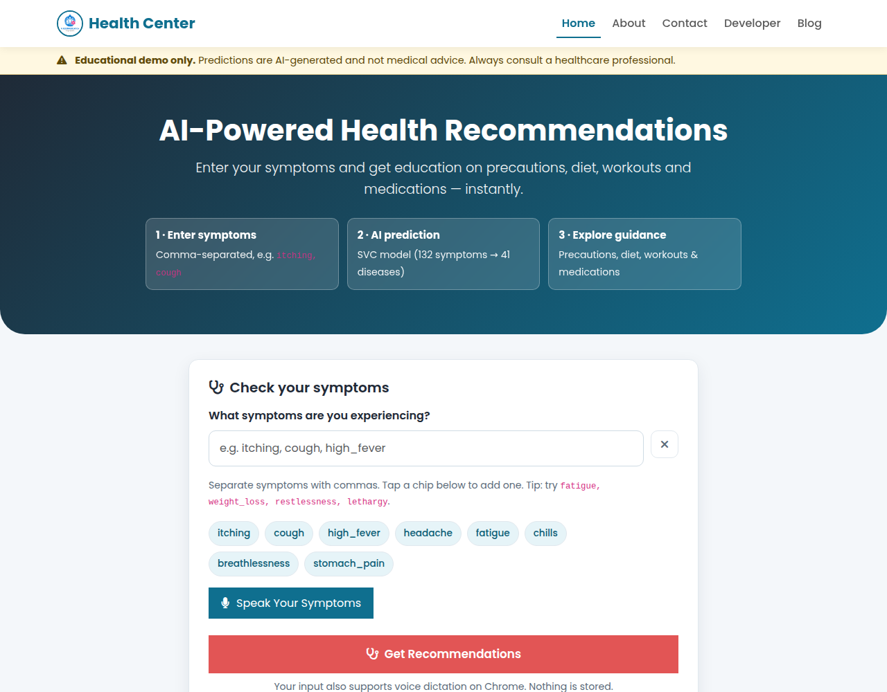
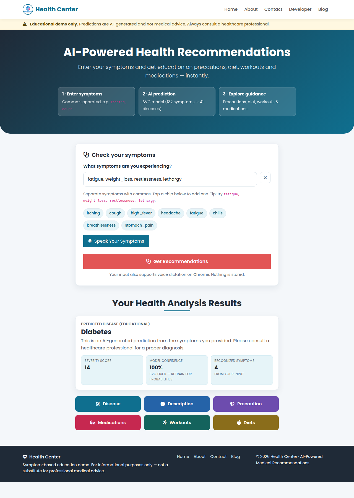
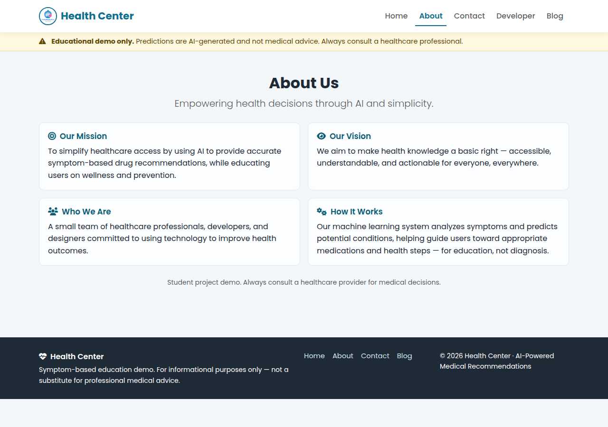
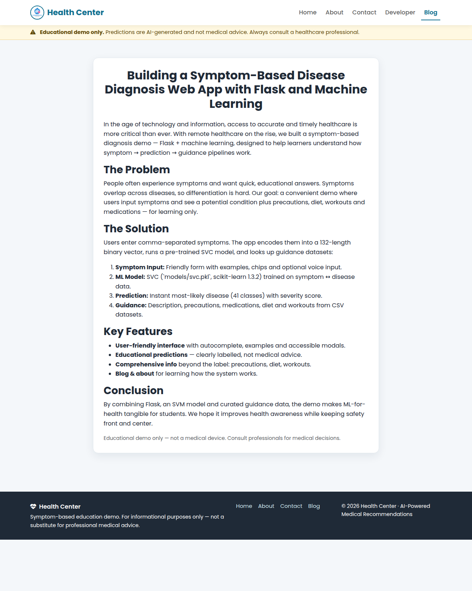
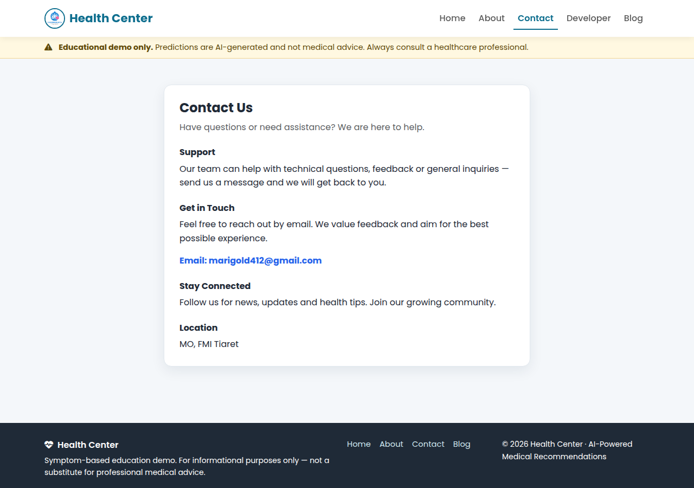
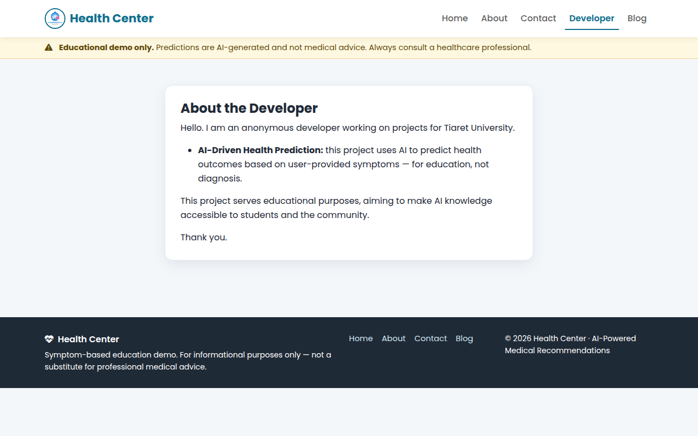

<div align="center">

# 🩺 Personalized Medical Recommendation System

### AI-powered symptom-based disease prediction with medications, diet, workouts & precautions

> **Disclaimer:** Educational Flask demo. Symptom-based disease prediction with medication and diet suggestions. **Not medical advice.**

[](https://www.python.org/)
[](https://flask.palletsprojects.com/)
[](https://scikit-learn.org/)
[](https://www.docker.com/)
[](https://railway.app/)
[](https://github.com/bmo1177/medication-recommender/actions)
[](./README.md)

**[Live Demo](https://github.com/bmo1177/medication-recommender#deployment)** · **[Quick Start](#-quick-start)** · **[How It Works](#-how-it-works)** · **[Deployment](#-deployment)** · **[Contributing](#-contributing)**

</div>

---

## 📋 Table of Contents

- [✨ Features](#-features)
- [🖼️ Screenshots](#️-screenshots)
- [⚙️ How It Works](#-how-it-works)
- [🧰 Tech Stack](#-tech-stack)
- [🚀 Quick Start](#-quick-start)
- [☁️ Deployment](#-deployment)
- [📁 Project Structure](#-project-structure)
- [🔌 Endpoints](#-endpoints)
- [📊 Datasets & Model](#-datasets--model)
- [🧠 Model Training](#-model-training)
- [🧪 Testing](#-testing)
- [🤝 Contributing](#-contributing)
- [🗺️ Roadmap](#️-roadmap)
- [⚠️ Disclaimer](#️-important-disclaimer)
- [📄 License](#-license)
- [👥 Authors](#-authors)

---

## ✨ Features

| Feature | Description |
|---|---|
| **Symptom-based prediction** | Enter comma-separated symptoms → instant disease prediction (132 symptoms, 41 diseases) |
| **Voice input** | Mic-enabled symptom entry on supported browsers |
| **Personalized recommendations** | Medications, precautions, diet plan and workout routine per predicted disease |
| **Severity scoring** | Weighted score from `Symptom-severity.csv` (real weights, not index sums) |
| **Input validation** | Unknown / misspelled symptoms are reported instead of crashing |
| **Production-ready** | `$PORT` / `DEBUG` env handling, `/health` check, Gunicorn + Docker, Railway/Render blueprints |
| **CI** | GitHub Actions on every push/PR (import + health check) |
| **Privacy-focused** | All inference runs locally on the server — no symptom data is stored |

**Sample inputs** (see `tests.txt`):

```text
fatigue, weight_loss, restlessness, lethargy
chills, fatigue, cough, high_fever
itching, skin_rash, burning_micturition
```

---

## 🖼️ Screenshots

| Homepage | Prediction result |
|---|---|
|  |  |

| About | Blog |
|---|---|
|  |  |

| Contact | Developer |
|---|---|
|  |  |

> Prediction demo: `fatigue, weight_loss, restlessness, lethargy` → **Diabetes** (severity 14). Captured 2026-11-08 from the redesigned UI (`home.png` 1280×1000, `prediction.png` 1280×1800).

---

## ⚙️ How It Works

```text
User symptoms  →  normalize (lowercase, _-separated, strip)
                 →  binary vector of length 132
                 →  SVC model (models/svc.pkl, scikit-learn 1.3.2)
                 →  predicted disease (41 classes)
                 →  lookup in datasets/*.csv
                      ├─ description.csv       → description
                      ├─ medications.csv       → medications
                      ├─ precautions_df.csv    → precautions
                      ├─ diets.csv             → diet plan
                      └─ workout_df.csv        → workout plan
                 →  severity score = Σ weight(symptom) from Symptom-severity.csv
                 →  rendered in templates/index.html
```

- **Model:** `Support Vector Classifier` trained in `Medicine Recommendation System.ipynb`, exported as `models/svc.pkl`
- **Training data:** `datasets/Training.csv` + `datasets/symtoms_df.csv`
- **Routes:** `/` · `/predict` (POST) · `/about` · `/contact` · `/developer` · `/blog` · `/health`

---

## 🧰 Tech Stack

| Layer | Technology |
|---|---|
| Backend | Python 3.11, Flask 3.0, Gunicorn |
| ML | scikit-learn 1.3.2 (SVC), pandas, numpy |
| Frontend | Jinja2 templates, vanilla HTML/CSS/JS, Font Awesome |
| Container | Docker (`python:3.11-slim`) |
| Hosting | Railway (Dockerfile / Procfile), Render (`render.yaml`) |
| CI | GitHub Actions (`.github/workflows/python-app.yml`) |

---

## 🚀 Quick Start

> **Local-first:** your laptop is the server — no cloud account, no card, no Docker required. Full guide: **[LOCAL_SETUP.md](./LOCAL_SETUP.md)**

### Prerequisites

- Python 3.11+ (3.12 works) — or Docker (no local Python)

### 30 seconds to running app

```bash
git clone https://github.com/bmo1177/medication-recommender.git
cd medication-recommender
make install
make run
```

Open **http://127.0.0.1:5000** — health check at **http://127.0.0.1:5000/health**.

No `make`? One-script alternative (does venv + install + smoke test + run):

```bash
./scripts/bootstrap.sh
```

Docker alternative:

```bash
docker compose up --build   # or: make docker
# open http://localhost:5000
```

Manual (Windows / no make):

```bash
python3 -m venv venv
# Windows:  venv\Scripts\activate
# macOS/Linux:  source venv/bin/activate
pip install -r requirements.txt
python main.py
```

Production-like (Gunicorn) / custom port:

```bash
gunicorn main:app --bind 0.0.0.0:5000 --workers 2 --timeout 120
PORT=8080 python main.py
```

---

## ☁️ Deployment

### Railway (recommended)

Railway auto-detects the `Dockerfile` — it binds to `$PORT`, so no env vars are required.

1. Go to [railway.app](https://railway.app) → **Login with GitHub** (`bmo1177`)
2. **+ New Project** → **Deploy from GitHub Repo** → `bmo1177/medication-recommender` → branch `main`
3. Click the service → **Settings** → **Networking** → **Generate Domain** → copy your live URL
4. Verify: `<your-domain>/health` → `{"status":"ok","symptoms":132,"diseases":41}`

Optional env var:

| Key | Value | Notes |
|---|---|---|
| `DEBUG` | `false` | Default. Set `true` only for local debugging |
| `PORT` | *(auto)* | Set by Railway — do not hardcode |

### Render

1. [render.com](https://render.com) → **New → Web Service** → connect `bmo1177/medication-recommender`
2. `render.yaml` auto-fills: Build `pip install -r requirements.txt`, Start `gunicorn main:app --bind 0.0.0.0:$PORT`, Health `/health`
3. Deploy → live at `https://medication-recommender.onrender.com`

### Docker (any host)

```bash
docker build -t medication-recommender .
docker run -d --name medication-recommender -p 5000:5000 medication-recommender
curl http://localhost:5000/health
```

---

## 📁 Project Structure

```text
medication-recommender/
├── main.py                     # Flask app (routes, prediction, severity)
├── requirements.txt            # Pinned dependencies (ml pickle-compatible)
├── Dockerfile                  # Railway-ready, binds to $PORT
├── Procfile                    # gunicorn main:app
├── render.yaml                 # Render blueprint
├── .python-version             # 3.11.9
├── .github/workflows/python-app.yml
├── datasets/                   # Canonical data (runtime + training)
│   ├── symtoms_df.csv
│   ├── Training.csv
│   ├── description.csv
│   ├── medications.csv
│   ├── diets.csv
│   ├── precautions_df.csv
│   ├── workout_df.csv
│   └── Symptom-severity.csv
├── models/
│   └── svc.pkl                 # Trained SVC (sklearn 1.3.2)
├── templates/                  # Flask templates (runtime)
│   ├── index.html              # Symptom form + results modal
│   ├── about.html
│   ├── contact.html
│   ├── developer.html
│   └── blog.html
├── static/                     # Static assets
├── diagrams/                   # UML diagrams
├── screenshots/
├── Medicine Recommendation System.ipynb
└── tests.txt                   # Sample symptom inputs
```

---

## 🔌 Endpoints

| Method | Path | Description |
|---|---|---|
| `GET` | `/` | Symptom form (index) |
| `POST` | `/predict` | Predict from `symptoms` form field (comma-separated, HTML) |
| `GET` | `/health` | `{"status":"ok","symptoms":132,"diseases":41,"model":"SVC"}` |
| `GET` | `/api/symptoms` | JSON list of 132 valid symptoms |
| `POST` | `/api/predict` | JSON `{"symptoms": [...] or "..."}` → `{predicted_disease, confidence, severity_score, description, precautions, medications, diet, workouts}`; `400` bad input / `422` unknown-only |
| `GET` | `/about` `/contact` `/developer` `/blog` | Static pages |

**API example:**

```bash
curl -s -X POST http://127.0.0.1:5000/api/predict \
  -H 'Content-Type: application/json' \
  -d '{"symptoms":["fatigue","weight_loss","restlessness","lethargy"]}'
```

---

## 📊 Datasets & Model

| File | Rows* | Purpose |
|---|---|---|
| `datasets/symtoms_df.csv` | 4921 | Symptom list / encoding source |
| `datasets/Training.csv` | 4921 | Training matrix (symptoms → disease) |
| `datasets/description.csv` | 41 | Disease descriptions |
| `datasets/medications.csv` | 41 | Medication per disease |
| `datasets/precautions_df.csv` | 41 | 4 precautions per disease |
| `datasets/diets.csv` | 41 | Diet plan per disease |
| `datasets/workout_df.csv` | 410 | Workout routine per disease |
| `datasets/Symptom-severity.csv` | 133 | Symptom → severity weight |

\*Row counts from the committed files; training notebook rebuilds `models/svc.pkl`.

> ⚠️ `models/svc.pkl` is loaded with `pickle`. It is **trusted-only** — never load a pickle from an untrusted source. The version-matched `scikit-learn==1.3.2` pin (see `requirements.txt`) avoids pickle version warnings.

---

## 🧠 Model Training

Full pipeline lives in **[`Medicine Recommendation System.ipynb`](./Medicine%20Recommendation%20System.ipynb)** (single source of truth — this section documents it).

### 1. Dataset

| Property | Value |
|---|---|
| File | `datasets/Training.csv` |
| Shape | **(4920, 133)** → 132 symptom columns + `prognosis` target |
| Features | 132 binary (0/1) symptoms (e.g. `itching`, `skin_rash`, `chills`, `high_fever` …) |
| Target | 41 diseases (`Fungal infection`, `Allergy`, `GERD`, `Diabetes`, …) |
| Type | Synthetic / curated symptom patterns (not EHR data) |

### 2. Preprocessing

```python
import pandas as pd
from sklearn.preprocessing import LabelEncoder
from sklearn.model_selection import train_test_split

dataset = pd.read_csv("Training.csv")          # (4920, 133)
X = dataset.drop("prognosis", axis=1)          # 132 binary symptoms
y = dataset["prognosis"]

le = LabelEncoder()                            # disease name -> int 0..40
Y = le.fit_transform(y)

X_train, X_test, y_train, y_test = train_test_split(
    X, Y, test_size=0.3, random_state=20       # 70/30 split, reproducible
)
```

- **No imputation / scaling** — features are already clean 0/1 indicators.
- **Label encoding** maps 41 string diagnoses to ints for the classifier; `main.py` mirrors this with `diseases_list` / `symptoms_dict`.

### 3. Models compared

Five candidates were trained and scored with `accuracy_score` + `confusion_matrix`:

| Model | Config | Notebook result |
|---|---|---|
| **SVC** | `SVC(kernel="linear")` | **1.0** accuracy |
| RandomForest | `RandomForestClassifier(n_estimators=100, random_state=42)` | **1.0** accuracy |
| GradientBoosting | `GradientBoostingClassifier(n_estimators=100, random_state=42)` | (see notebook) |
| KNeighbors | `KNeighborsClassifier(n_neighbors=5)` | (see notebook) |
| MultinomialNB | `MultinomialNB()` | (see notebook) |

The linear **SVC** was selected (simplest perfect scorer) and refit:

```python
from sklearn.svm import SVC
from sklearn.metrics import accuracy_score
import pickle

svc = SVC(kernel="linear")
svc.fit(X_train, y_train)
accuracy_score(y_test, svc.predict(X_test))    # 1.0 on the 30% holdout
pickle.dump(svc, open("svc.pkl", "wb"))        # -> models/svc.pkl
```

Environment verified in the notebook: **`scikit-learn 1.3.2`** — hence the exact pin in `requirements.txt` (avoid pickle version warnings).

### 4. Inference (what `main.py` does)

```text
raw input "itching, cough, high_fever"
  -> normalize (lower, _-separated, dedupe)
  -> binary vector len 132
  -> ModelPredictor.predict() -> disease label
  -> DiseaseKnowledgeBase.details(disease) -> O(1) dict lookup
       description + precautions + medications + diet + workouts
  -> + severity score = Σ weight(symptom) from Symptom-severity.csv
```

`ModelPredictor` wraps **any** sklearn classifier with `.predict()` (and `.predict_proba()` if present), so swapping a retrained SVC / Random Forest / calibrated model needs no route changes — just replace `models/svc.pkl` and keep `scikit-learn` pinned to the training version.

### 5. Limitations & what "1.0 accuracy" really means

- **Synthetic data:** 1.0 on a holdout means the 132 patterns separate cleanly — it does **not** imply clinical accuracy. Real-world symptoms overlap and require clinician judgment.
- **Uncalibrated:** `SVC(kernel="linear", probability=False)` returns no probabilities → the UI reports a fixed 100%. Use `SVC(probability=True)` or `CalibratedClassifierCV` for real confidence.
- **No drift / validation:** single 70/30 split, no cross-validation, no patient-level split.
- **Pickle trust:** only load pickles you trained yourself.

### 6. Retrain smoke test

```bash
.venv/bin/python -c "
import pandas as pd, pickle
df = pd.read_csv('datasets/Training.csv')
print(df.shape)
import sklearn; print('sklearn', sklearn.__version__)
"
```

To retrain end-to-end, open the notebook top-to-bottom (run Cells 3–15), then verify:

```bash
.venv/bin/python -c "from main import app; print(app.test_client().get('/health').json)"
```

---

## 🧪 Testing

- **Local smoke test** (also run in CI):

  ```bash
  python -c "import main; print('OK: app imported')"
  python -c "from main import app; c=app.test_client(); print(c.get('/health').json)"
  ```

- **Sample inputs:** [`tests.txt`](./tests.txt)
- **CI:** `.github/workflows/python-app.yml` — install + import + `/health` on every push/PR to `main`

---

## 🤝 Contributing

Contributions are welcome!

1. Fork `bmo1177/medication-recommender`
2. Create a feature branch: `git checkout -b feat/your-feature`
3. Commit with a clear message and push
4. Open a Pull Request against `main` (CI runs automatically)

Please try to keep changes focused and update `README.md` when behavior changes.

---

## 🗺️ Roadmap

- [x] Production-ready Flask (`$PORT`, `/health`, input validation)
- [x] Severity scoring from weights file
- [x] Docker + Railway + Render + GitHub Actions CI
- [ ] `POST /api/predict` JSON endpoint (currently form-only)
- [ ] Confidence via `probability=True` retraining
- [ ] Unit tests (`pytest` for `helper` + routes)
- [ ] Frontend polish (loading states, error toasts, mobile layout)

---

## ⚠️ Important Disclaimer

> **Warning:** This system is for **educational purposes only**. It is **not** intended to replace professional medical advice. Always consult a qualified healthcare provider for medical decisions.

---

## 📄 License

Academic / educational project. No warranty. See repository history for attribution.

---

## 👥 Authors

- **Mohamed Oussama Belalia** ([@bmo1177](https://github.com/bmo1177)) — creator
- Educational project only.

<div align="center">

Made with Flask, scikit-learn & ❤️ · <a href="https://github.com/bmo1177/medication-recommender">⭐ Star on GitHub</a>

</div>
